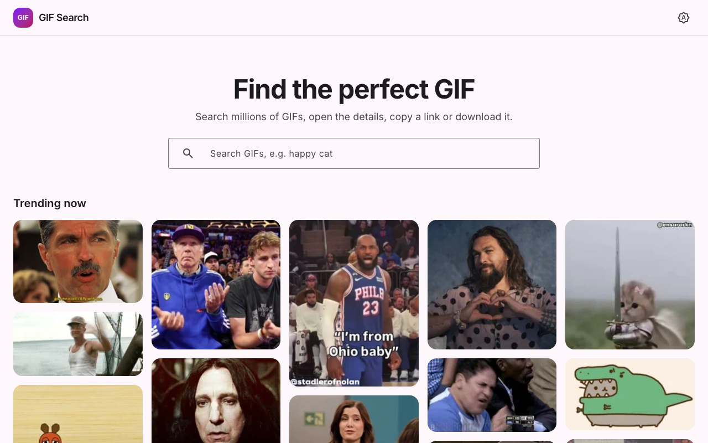

# GIF Search

Search GIPHY, open a GIF's details, copy its link or download it. Built with Angular 22 (standalone,
zoneless, signals), Angular Material 3 and Tailwind CSS v4.

**Live demo:** [syn1ak.github.io/gif-search](https://syn1ak.github.io/gif-search/)



## Features

- **Search as you type.** A 500 ms debounce after 2+ characters, or Enter to search at once. Queries over
  50 characters show a validation error and never reach the API.
- **Trending first.** An empty search field shows GIPHY's trending GIFs.
- **Infinite scroll.** The next 30 results load as you near the bottom, until GIPHY has no more.
- **Details dialog.** The full-size GIF with its author, creation date, rating, dimensions, file size and
  source. Full-screen on phones.
- **Copy and download.** Copy the direct `.gif` link or the GIPHY page link (also from a card's quick-copy
  button). Download saves the file as `<slug>-<id>.gif`.
- **Shareable URLs.** `?q=cats` keeps the search and `?gif=<id>` the open GIF, so reload, Back/Forward and
  shared links all work.
- **Light, dark or system theme**, remembered across visits, with no flash of the wrong theme on load.
- **Clear error states.** Invalid API key, rate limit, offline and unknown GIF each get their own message,
  with **Try again** where retrying can help.
- **Accessible.** Keyboard-operable cards and dialog, a skip link, and still frames when the OS asks for
  reduced motion. Lighthouse Accessibility scores 100.

## Quick start

Requirements: **Node 24** and npm. The `env` script uses `node --env-file-if-exists`, which needs
Node 22.9 or later.

```bash
git clone <repository-url> gif-search
cd gif-search
cp .env.example .env    # then put your key in .env: GIPHY_API_KEY=...
npm install             # also generates src/environments/environment.generated.ts
npm start               # http://localhost:4200
```

Get a free key at the [GIPHY developer dashboard](https://developers.giphy.com/dashboard/): create an app
and choose **API** (not SDK). A beta key allows 100 requests per hour, which is plenty for development.

Without a key the app still builds and runs; it shows the "API key is missing or invalid" state. The
automated tests never need a key.

### Running the tests

```bash
npm test                              # unit and component tests (Vitest)
npx playwright install chromium       # once, before the first e2e run
npm run e2e                           # end-to-end tests (Playwright); starts its own dev server
```

## Commands

| Command                                   | What it does                                                                                            |
| ----------------------------------------- | ------------------------------------------------------------------------------------------------------- |
| `npm start`                               | Generate the environment file, then serve the app at http://localhost:4200                              |
| `npm run build`                           | Production build into `dist/gif-search/browser`                                                         |
| `npm run watch`                           | Development build that rebuilds on change                                                               |
| `npm test`                                | Unit and component tests, single run                                                                    |
| `npm run test:watch`                      | Unit tests in watch mode                                                                                |
| `npm run test:coverage`                   | Unit tests with coverage; fails below 80% lines in `core/`, `shared/` or any `data-access/`             |
| `npm run e2e`                             | Type-check and run the Playwright suite (desktop Chrome and Pixel 7), with the GIPHY API mocked         |
| `npm run e2e:ui`                          | Playwright's interactive runner                                                                         |
| `npm run lint` / `npm run lint:fix`       | ESLint (angular-eslint), with fixes                                                                     |
| `npm run format` / `npm run format:check` | Prettier, write or check                                                                                |
| `npm run env`                             | Regenerate `src/environments/environment.generated.ts` from `GIPHY_API_KEY` (`.env` or the environment) |

## About the API key and GIPHY's terms

GIPHY's API is designed to be called from the browser, so the key is compiled into the public JavaScript
bundle and anyone can read it. That is acceptable for a rate-limited beta key, which is what this project
uses; do not deploy a key you need to keep private. The key itself is never committed: `.env` and the
generated environment file are gitignored.

In line with GIPHY's terms, the footer shows **Powered by GIPHY**, media URLs are used exactly as GIPHY
returns them, and nothing is proxied through a server.

## Architecture

The code is layered and domain-driven:

```
src/app/
├── core/      Headless building blocks: GIPHY client and DTOs, interceptors, tokens, theme and download services
├── layout/    The app shell: header (logo, theme toggle) and footer (GIPHY attribution)
├── domains/   Business domains. gifs/ holds the GIF view model, its mapper, the GIF card and shared messages
│   └── gifs/
│       ├── features/gif-details-modal/   Details dialog with copy and download, usable by any page
│       └── pages/gif-search/             The search page, lazy-loaded through its own routes file
└── shared/    Generic UI with no business logic: base form control and input, infinite-scroll and image-loading directives
```

**Dependency rules**

- Dependencies point one way: `pages → features → domain-level models/utils/view → shared/ui → core`.
  `layout` may use `core` and `shared/ui`.
- No sibling imports: a page never imports another page, a feature never imports another feature. Code
  both need moves up to their nearest common parent.
- `core/` is headless and never imports from `domains/`. `shared/ui/` talks only through inputs and outputs.
- Every page and feature splits `data-access/` (a **facade** plus services) from `view/` (components,
  pipes). Components talk only to their facade.
- GIPHY is the source of truth: data is re-fetched, never patched locally.

**Key decisions**

| Decision                                                                                                                                         | Why                                                                                                               |
| ------------------------------------------------------------------------------------------------------------------------------------------------ | ----------------------------------------------------------------------------------------------------------------- |
| The URL drives state: `?q` runs the search and `?gif` opens the dialog; the UI only changes the URL.                                             | Reload, Back/Forward and shared links work without any two-way syncing.                                           |
| Facades keep state in signals and use RxJS (`Subject → switchMap`) for requests.                                                                 | Signals for rendering; RxJS for cancelling stale requests, debouncing and retrying.                               |
| Facades are provided by the page's route, not the root injector.                                                                                 | Their state lives exactly as long as the page.                                                                    |
| The masonry grid places each GIF in the shortest column, using GIPHY's width and height.                                                         | Unlike CSS columns, loading more results never reflows the cards already shown, and there is no layout shift.     |
| `core/` interceptors add the API key (GIPHY's host only) and turn every failure, including GIPHY's "synthetic" 200 errors, into one typed error. | Clients stay simple URL builders and the UI switches on a single error type.                                      |
| The key comes from `.env` through a generated, gitignored file; a missing key gives an empty string and a warning.                               | A fresh clone always builds, and the missing-key state explains itself.                                           |
| Tailwind v4 lives in plain CSS, the Material theme in SCSS, and Material's colour tokens are mapped into Tailwind.                               | Tailwind never passes through Sass, and both share one palette that follows the theme.                            |
| Form controls extend `ABaseInputComponent<T>`, which registers itself as the `ControlValueAccessor` through `NgControl`.                         | Access to the bound control's validators and errors, without the circular-dependency trap of `NG_VALUE_ACCESSOR`. |
| Playwright came early, and every feature shipped with its own e2e scenario.                                                                      | The regression net grew with the app, and the API quota was never touched.                                        |

The full specification and the implementation plan are in [`.claude/SPEC.md`](.claude/SPEC.md) and
[`.claude/tasks/`](.claude/tasks/).

## Testing

- **Unit and component tests** (Vitest, TestBed, `HttpTestingController`) sit next to the code as
  `*.spec.ts`: the mapper and pipes, the GIPHY client and interceptors, the facades and services, and the
  key components. `npm run test:coverage` enforces at least 80% line coverage in `core/`, `shared/` and every
  `data-access/` folder (see `vitest-base.config.mts`).
- **End-to-end tests** (Playwright, in `e2e/`) run real user journeys in desktop Chrome and on a Pixel 7
  viewport. `e2e/support/giphy-mock.ts` answers every GIPHY call from in-test data and serves a tiny local
  GIF for all media. A test fails if the app calls an endpoint the test did not mock, or if the page logs a
  console error or warning.
- Automated tests never call the real GIPHY API.
